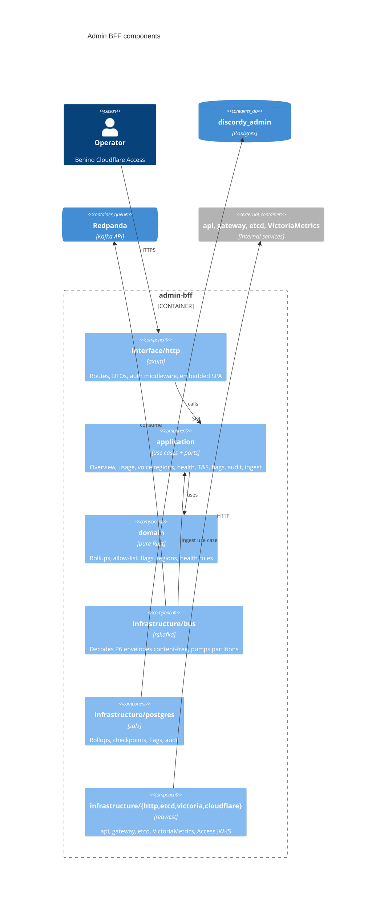

# Architecture

Clean Architecture inside `bff/src`: `domain` (pure rules, no IO) <- `application` (use cases and ports) <- `infrastructure` (adapters) and `interface` (HTTP), wired in `bootstrap.rs`. Dependencies point inward only.

## Usage aggregation

One consumer task per partition decodes only the envelope header fields (type, timestamp, ids) and classifies them into counters; message bodies are never deserialised. Counts accumulate into a delta, and the delta and the partition offset are committed in one Postgres transaction, so a crash can neither lose nor double count. A bounded memory of recent event ids drops redeliveries. Rollups are kept at minute, hour and day granularity and pruned by age.

## Reports queue

The Reports page lists the reports the api stores (`GET /admin-api/reports?status=open|resolved|dismissed`, cursor `after`) and closes them (`POST /admin-api/reports/{id}/resolve` with `resolution` and an optional note). Both calls go to the api internal admin API; the BFF stores nothing about a report, only passes the reported message text through to the page. Closing a report writes an audit entry (`report.resolve` or `report.dismiss`) with the report id, kind, category, reported account and note, never the message content. Reports follow the existing permission model: every allow-listed operator can review and close them. The reporter is shown to operators only; no route of the api exposes a report to the reported user. Message text comes with its source: copied by the api when the report was filed, or submitted by the reporter for ephemeral and P2P chats (unverified, the server has no copy).

## Auth

The `require_admin` middleware runs the `AuthenticateAdmin` use case: verify the Cloudflare Access JWT through the `AccessTokenVerifier` port (JWKS cached), then check the email against the domain `AdminAllowlist`. The dev header is honoured only when `DISCORDY_ENV=local`.

## Web

`web/` is a Vite SPA with one typed API client, a `useAsync` loader, Recharts-based time-series components that follow the data-viz rules (fixed categorical order, one axis, legend, table view, status as icon plus label), and Nightglass design tokens shared with the client. `rust-embed` bakes `web/dist` into the binary; unknown non-file paths fall back to `index.html`.
